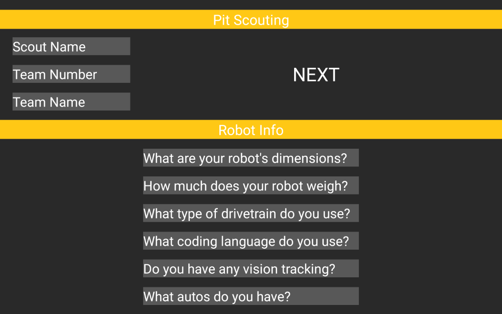
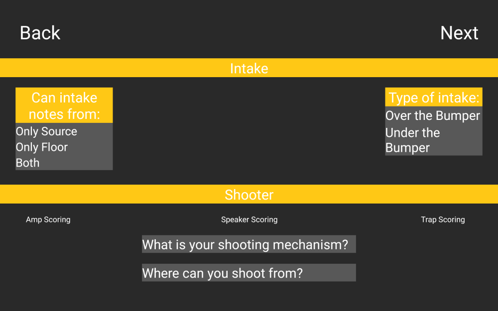
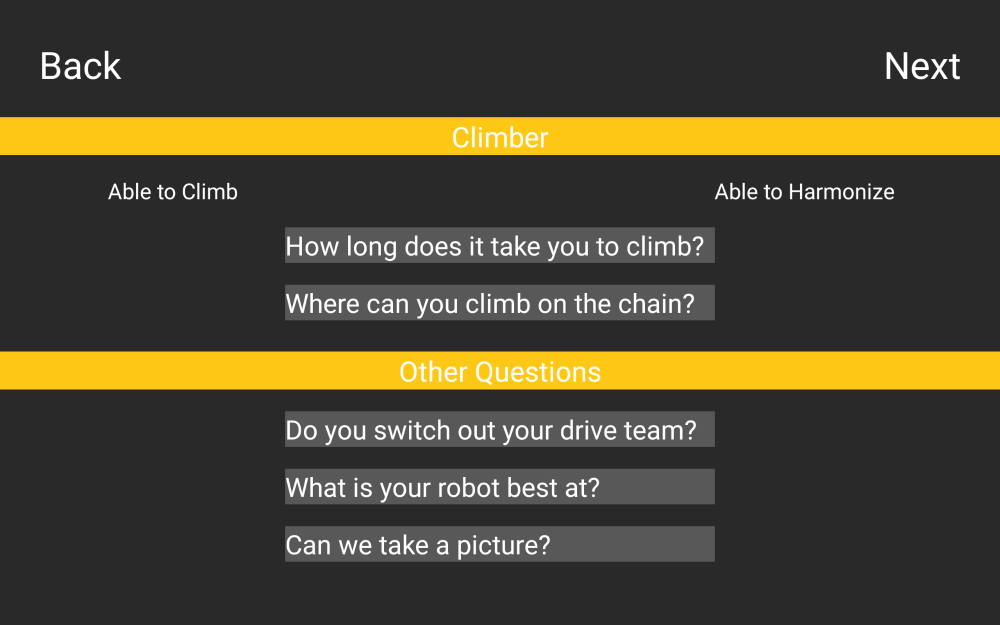
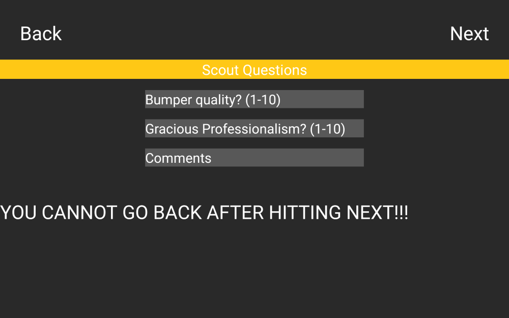
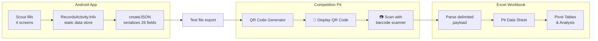

# FRC 2024 Crescendo Pit Scouting App

<div align="center">

[](https://developer.android.com/)
[](https://www.java.com/)
[](https://developer.android.com/about/versions/nougat)
[](https://firstfrc.blob.core.windows.net/frc2024/Manual/2024GameManual.pdf)

**Android app that standardizes pit interviews into 26 structured fields, exported via QR code for offline data collection at FRC competitions.**

[Features](#features) · [Screenshots](#screenshots) · [Architecture](#architecture) · [Usage Stats](#usage-stats) · [Build](#build-instructions)

</div>

---

## Background

My freshman year (2022), I served as a scout lead on [FRC Team 1730](https://www.thebluealliance.com/team/1730/2022) and learned the ropes from seniors Heath Crump and Caden Findlay. That year, the team won the [Newton Division](https://www.thebluealliance.com/event/2022new) and competed on [Einstein](https://www.thebluealliance.com/event/2022cmptx). Sophomore year, I took over as sole developer and built the [2023 match scouting app](https://github.com/aamir-frc-scouting/frc-scouting-app-2023) from scratch — Java, XML layouts, QR encoding into Excel.

Junior year (this app), I kept the [match scouting app](https://github.com/aamir-frc-scouting/frc-scouting-app-2024) running for Crescendo and identified a new bottleneck: pit scouting. Paper forms got lost, scouts asked inconsistent questions, and transcribing robot specs into spreadsheets wasted hours. This app standardizes the entire pit interview workflow — every scout asks the same 26 questions, data exports instantly via QR, and the strategy team has clean data before alliance selection.

— [Aamir Abatiyow](https://github.com/AamirAbatiyow)

## Screenshots

<div align="center">
<table>
  <tr>
    <td align="center"><br/><b>Team & Robot Info</b></td>
    <td align="center"><br/><b>Intake & Shooter</b></td>
    <td align="center"><br/><b>Climber & Other</b></td>
  </tr>
  <tr>
    <td align="center" colspan="3"><br/><b>Scout Review & Submit</b></td>
  </tr>
</table>

<sub>Rendered at 10" portrait tablet size, the devices the team scouted on.</sub>
</div>

## Features

- **Guided 4-screen flow** — Ensures scouts collect complete data in a consistent order
- **Crescendo-specific fields** — Intake source/type, amp/speaker/trap scoring, climb/harmonize capabilities
- **Compact QR-ready payload** — 26 fields encoded in a delimiter-separated format for fast scanning
- **Persistent scout name** — Reduces repetitive data entry between teams
- **Tablet-optimized layout** — Large touch targets and high-contrast Team Driven colors (yellow/dark grey)
- **Offline-first** — No network required; all data stored locally until QR export

## Usage Stats

<table>
<tr>
<td>

### Events Scouted

| Event | Teams | Data Points |
|:------|------:|------------:|
| [Green Country Regional](https://www.thebluealliance.com/event/2024oktu) | 43 | 1,118 |
| [Heartland Regional](https://www.thebluealliance.com/event/2024ksla) | 36 | 936 |
| [Greater Kansas City Regional](https://www.thebluealliance.com/event/2024mokc) | 42 | 1,092 |
| [Houston Champs — Milstein Division](https://www.thebluealliance.com/event/2024mil) | 75 | 1,950 |
| [MO-KAN State Championship](https://www.thebluealliance.com/event/2024mksc) | 34 | 884 |

</td>
<td>

### Season Totals

| Metric | Count |
|:-------|------:|
| Events | 5 |
| Teams Scouted | 230 |
| Fields per Team | 26 |
| **Total Data Points** | **5,980** |

</td>
</tr>
</table>

<sub>Data points = teams × 26 fields. See [Team 1730 on TBA](https://www.thebluealliance.com/team/1730/2024).</sub>

**On-field results supported:** [Green Country Regional](https://www.thebluealliance.com/event/2024oktu) winners; [Heartland Regional](https://www.thebluealliance.com/event/2024ksla) finalists + Impact Award; [Greater Kansas City Regional](https://www.thebluealliance.com/event/2024mokc) #1 seed; [Milstein Division](https://www.thebluealliance.com/event/2024mil) finalists; [MO-KAN](https://www.thebluealliance.com/event/2024mksc) winners.

## Architecture

### Data Flow



### QR Payload Format

The app encodes all 26 fields into a compact delimiter-separated string:

```
!{scoutName}*{teamNumber}*{teamName}*{dimensions}*...
```

### Field Reference (26 Fields)

| # | Field | Type | Screen |
|---|-------|------|--------|
| 1 | scoutName | String | Main |
| 2 | teamNumber | String | Main |
| 3 | teamName | String | Main |
| 4 | dimensions | String | Main |
| 5 | weight | String | Main |
| 6 | drivetrain | String | Main |
| 7 | codingLanguage | String | Main |
| 8 | visionTracking | String | Main |
| 9 | autonomous | String | Main |
| 10 | intakeFrom | Enum: Source/Floor/Both | Match |
| 11 | intakeType | Enum: Over/Under Bumper | Match |
| 12 | ampScoring | Boolean | Match |
| 13 | speakerScoring | Boolean | Match |
| 14 | trapScoring | Boolean | Match |
| 15 | shootingMechanism | String | Match |
| 16 | shootingLocation | String | Match |
| 17 | climb | Boolean | End |
| 18 | harmonize | Boolean | End |
| 19 | climbTime | String | End |
| 20 | climbPosition | String | End |
| 21 | driveTeam | String | End |
| 22 | bestAt | String | End |
| 23 | picture | String | End |
| 24 | bumper | String (1-10) | After |
| 25 | gp | String (1-10) | After |
| 26 | comments | String | After |

### Project Structure

```
app/src/main/java/com/example/pitscouting2024/
├── MainActivity.java      # Team info + robot specs (screen 1)
├── MatchActivity.java     # Intake + shooter capabilities (screen 2)
├── EndActivity.java       # Climber + other questions (screen 3)
├── AfterActivity.java     # Scout observations + submit (screen 4)
└── RecordsActivity.java   # Static data holder + payload serialization
```

## Build Instructions

### Requirements

- **Java 17+** (JDK)
- **Android SDK** with API 34 (compile) and API 24+ (minimum)

### Steps

1. Clone the repository:
   ```bash
   git clone https://github.com/aamir-frc-scouting/frc-pit-scouting-app-2024.git
   cd frc-pit-scouting-app-2024
   ```

2. Set `ANDROID_HOME` if not already configured:
   ```bash
   export ANDROID_HOME=/path/to/android/sdk
   ```

3. Build the debug APK:
   ```bash
   ./gradlew assembleDebug
   ```

4. Install on a connected device:
   ```bash
   adb install app/build/outputs/apk/debug/app-debug.apk
   ```

## What Came Next

Senior year (2025), I rewrote the entire scouting ecosystem in Dart/Flutter:

| Season | App | Stack | Scale |
|--------|-----|-------|-------|
| 2025 | [Match Scouting](https://github.com/aamir-frc-scouting/frc-scouting-app-2025) | Dart/Flutter | 3 events, 44K data points |
| 2025 | [Pit Scouting](https://github.com/aamir-frc-scouting/frc_pit_scouting_app_2025) | Dart/Flutter | 147 teams, 39 fields |

The 2025 rewrite kept the QR transfer: Flutter apps generate the QR code, and a Python/customtkinter desktop intake app scans, validates, and inserts each record into SQLite — so strategy questions become SQL queries instead of Excel formulas.

## Tech Stack

| Component | Technology |
|-----------|------------|
| Language | Java 8 |
| Platform | Android (API 24+) |
| UI | ConstraintLayout, Material Components |
| Build System | Gradle 8.2, AGP 8.2.2 |
| Data Format | Delimiter-separated string (`!`/`*`) |
| Data Import | Excel (external) |

## License

This repository does not currently have a license. Please contact the author before using this code in your own projects.

---

<div align="center">

**Part of the [Team 1730 scouting system](https://github.com/aamir-frc-scouting)**

[2023 Match](https://github.com/aamir-frc-scouting/frc-scouting-app-2023) · [2024 Match](https://github.com/aamir-frc-scouting/frc-scouting-app-2024) · **2024 Pit** · [2025 Match](https://github.com/aamir-frc-scouting/frc-scouting-app-2025) · [2025 Pit](https://github.com/aamir-frc-scouting/frc_pit_scouting_app_2025)

</div>
