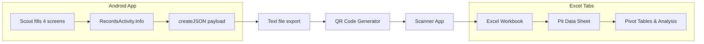

# FRC Pit Scouting App 2024

**Structured pit interviews in 60 seconds—no paper, no duplicates, no lost data.**

[](https://developer.android.com/)
[](https://www.java.com/)
[](https://developer.android.com/studio/releases/platforms)
[](https://www.thebluealliance.com/team/1730)

---

## The Problem

During my junior year (2024), I identified pit scouting as a critical bottleneck for [FRC Team 1730 (Team Driven)](https://www.thebluealliance.com/team/1730). While our match scouting app was working well, pit interviews were still chaotic: paper forms got lost, scouts asked inconsistent questions, and manually transcribing robot specs into spreadsheets wasted hours of prep time. This app standardizes the entire pit scouting workflow—every scout asks the same 26 questions, data exports instantly via QR code, and our strategy team has clean, structured data before alliance selection begins.

---

## Screenshots

<table>
  <tr>
    <td align="center"><br/><b>Team & Robot Info</b></td>
    <td align="center"><br/><b>Intake & Shooter</b></td>
  </tr>
  <tr>
    <td align="center"><br/><b>Climber & Other</b></td>
    <td align="center"><br/><b>Scout Review & Submit</b></td>
  </tr>
</table>

---

## Features

- **Guided 4-screen flow** — Ensures scouts collect complete data in a consistent order
- **Crescendo-specific fields** — Intake source/type, amp/speaker/trap scoring, climb/harmonize capabilities
- **Compact QR-ready payload** — 26 fields encoded in a delimiter-separated format for fast scanning
- **Persistent scout name** — Reduces repetitive data entry between teams
- **Tablet-optimized layout** — Large touch targets and high-contrast Team Driven colors (yellow/dark grey)
- **Offline-first** — No network required; all data stored locally

---

## Usage Stats (2024 Season)

This app was deployed at **5 events**, collecting data on **230 teams** with **5,980 data points**:

| Event | Teams | Data Points | Link |
|-------|------:|------------:|------|
| Green Country Regional | 43 | 1,118 | [TBA](https://www.thebluealliance.com/event/2024oktu) |
| Heartland Regional | 36 | 936 | [TBA](https://www.thebluealliance.com/event/2024ksla) |
| Greater Kansas City Regional | 42 | 1,092 | [TBA](https://www.thebluealliance.com/event/2024mokc) |
| Milstein Division (Houston Champs) | 75 | 1,950 | [TBA](https://www.thebluealliance.com/event/2024mil) |
| MO-KAN State Championship | 34 | 884 | [TBA](https://www.thebluealliance.com/event/2024mksc) |

**On-field results supported:** Green Country Regional winners; Heartland finalists + Impact Award; Greater Kansas City #1 seed; Milstein Division finalists; MO-KAN winners.

See more at [Team 1730 on The Blue Alliance](https://www.thebluealliance.com/team/1730).

---

## Architecture

### Data Flow



### QR Payload Format

The app encodes all 26 fields into a compact delimiter-separated string:

```
!{scoutName}*{teamNumber}*{teamName}*{dimensions}*{weight}*{drivetrain}*...
```

**Field order (26 fields):**

| # | Field | Type | Screen |
|---|-------|------|--------|
| 1 | scoutName | String | Main |
| 2 | teamNumber | String | Main |
| 3 | teamName | String | Main |
| 4 | dimensions | String | Main |
| 5 | weight | String | Main |
| 6 | drivetrain | String | Main |
| 7 | codingLanguage | String | Main |
| 8 | visionTracking | String | Main |
| 9 | autonomous | String | Main |
| 10 | intakeFrom | Enum: Source/Floor/Both | Match |
| 11 | intakeType | Enum: Over/Under the Bumper | Match |
| 12 | ampScoring | Boolean | Match |
| 13 | speakerScoring | Boolean | Match |
| 14 | trapScoring | Boolean | Match |
| 15 | shootingMechanism | String | Match |
| 16 | shootingLocation | String | Match |
| 17 | climb | Boolean | End |
| 18 | harmonize | Boolean | End |
| 19 | climbTime | String | End |
| 20 | climbPosition | String | End |
| 21 | driveTeam | String | End |
| 22 | bestAt | String | End |
| 23 | picture | String | End |
| 24 | bumper | String (1-10) | After |
| 25 | gp | String (1-10) | After |
| 26 | comments | String | After |

### Project Structure

```
app/src/main/java/com/example/pitscouting2024/
├── MainActivity.java      # Team info + robot specs (screen 1)
├── MatchActivity.java     # Intake + shooter capabilities (screen 2)
├── EndActivity.java       # Climber + other questions (screen 3)
├── AfterActivity.java     # Scout observations + submit (screen 4)
└── RecordsActivity.java   # Static data holder + payload serialization
```

---

## Build Instructions

### Prerequisites

- **Java 17+** (JDK)
- **Android SDK** with:
  - Platform SDK 34 (Android 14)
  - Build Tools 34.0.0

### Build

```bash
# Clone the repository
git clone https://github.com/aamir-frc-scouting/frc-pit-scouting-app-2024.git
cd frc-pit-scouting-app-2024

# Set ANDROID_HOME if not already configured
export ANDROID_HOME=/path/to/android/sdk

# Build debug APK
./gradlew assembleDebug

# APK location: app/build/outputs/apk/debug/app-debug.apk
```

### Install on Device

```bash
adb install app/build/outputs/apk/debug/app-debug.apk
```

---

## What Came Next

In 2025, I rewrote the entire scouting ecosystem in **Dart/Flutter**:

- Cross-platform Flutter app (Android)
- Same QR transfer, scanned into a Python/customtkinter desktop intake app
- SQLite instead of Excel, so questions become SQL queries
- 39 fields for the 2025 Reefscape game

See the full suite of apps at [github.com/aamir-frc-scouting](https://github.com/aamir-frc-scouting).

---

## License

This repository does not currently include a license. If you'd like to use or adapt this code, please open an issue to discuss licensing options.

---

<p align="center">
  Built by <a href="https://github.com/aamir-frc-scouting">Aamir Abatiyow</a> for FRC Team 1730 — Team Driven
</p>
